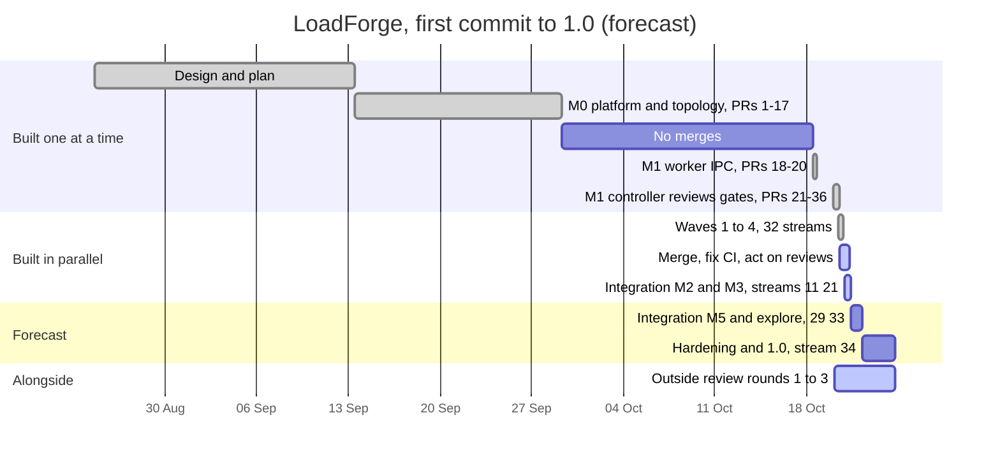
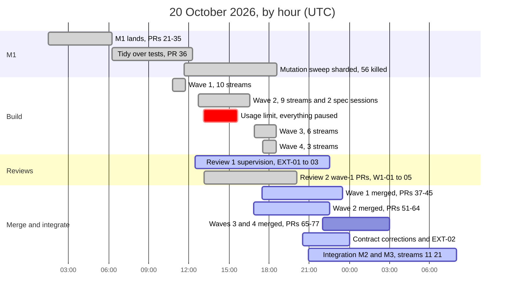

<!-- SPDX-License-Identifier: GPL-3.0-or-later -->
# LoadForge timeline, as of 2026-10-20 21:00 UTC

A dated snapshot of the project timeline, kept for history; a later snapshot is a new
dated file. The same data as an interactive page:
[gantt-2026-10-20-2100-UTC.html](gantt-2026-10-20-2100-UTC.html).

Bars marked *done* are finished, *active* are in progress, and plain bars are
**forecasts at this day's pace**, not commitments. Integration is the first test of
whether independently built components fit together, so it is the likeliest place for
the forecast to slip. All times are UTC.

## The whole project, by day

From 29 September to 18 October no pull request merged. Everything from M1's
controller onward happened on 20 October and is drawn by the hour in the next chart.

## 20 October, by hour

Thirty-two streams were built by parallel sessions against frozen contracts, each with
its own tests. The usage limit stopped every session from 13:05 to 15:40 (the *crit*
bar); a "continue" at the reset resumed them all.

## The same data as a table

| Scale | Work | Start (UTC) | End (UTC) | Status |
|---|---|---|---|---|
| Project | Design and plan | 2026-08-24 15:00 | 2026-09-13 12:00 | Done |
| Project | M0: platform and topology (PRs #1–#17) | 2026-09-13 12:00 | 2026-09-29 08:00 | Done |
| Project | M1: worker IPC (PRs #18–#20) | 2026-10-18 12:00 | 2026-10-18 19:00 | Done |
| Project | M1: controller, reviews, gates (PRs #21–#36) | 2026-10-20 00:00 | 2026-10-20 12:16 | Done |
| Project | Waves 1–4 built (32 streams) | 2026-10-20 10:45 | 2026-10-20 18:35 | Done |
| Project | Merge, fix CI, act on reviews (PRs #37–#79) | 2026-10-20 12:16 | 2026-10-21 06:00 | In progress |
| Project | Integration M2 and M3 (streams 11, 21) | 2026-10-20 20:55 | 2026-10-21 08:00 | In progress |
| Project | Integration M5, explore on controller (streams 29, 33) | 2026-10-21 08:00 | 2026-10-22 06:00 | Forecast |
| Project | Hardening and 1.0 (stream 34) | 2026-10-22 06:00 | 2026-10-24 18:00 | Forecast |
| Project | Outside review rounds (requests #1–#3) | 2026-10-20 01:52 | 2026-10-24 18:00 | In progress |
| 20 Oct | M1 lands (#21–#35) | 01:30 | 06:15 | Done |
| 20 Oct | Tidy over tests (#36) | 06:15 | 12:16 | Done |
| 20 Oct | Wave 1 built (10 streams) | 10:46 | 11:46 | Done |
| 20 Oct | Mutation sweep sharded, 56 survivors killed (#46, #53–#55) | 11:38 | 18:36 | Done |
| 20 Oct | Review 1: supervision (EXT-01–03) | 12:29 | 22:30 | In progress |
| 20 Oct | Wave 2 built (9 streams + 2 spec sessions) | 12:42 | 16:34 | Done |
| 20 Oct | Usage limit reached, everything paused | 13:05 | 15:40 | Paused |
| 20 Oct | Review 2: wave-1 PRs (W1-01–05) | 13:09 | 20:03 | Done |
| 20 Oct | Wave 1 merged (#37–#45) | 17:27 | 23:30 | In progress |
| 20 Oct | Wave 3 built (6 streams) | 16:55 | 18:33 | Done |
| 20 Oct | Wave 4 built (3 streams) | 17:30 | 18:33 | Done |
| 20 Oct | Wave 2 merged (#51–#64) | 16:51 | 22:30 | In progress |
| 20 Oct | Waves 3–4 merged (#65, #69–#77) | 22:00 | 03:00 (21 Oct) | Forecast |
| 20 Oct | Contract corrections, EXT-02 | 20:30 | 00:00 (21 Oct) | In progress |
| 20 Oct | Integration M2 and M3 (streams 11, 21) | 20:55 | 08:00 (21 Oct) | In progress |
